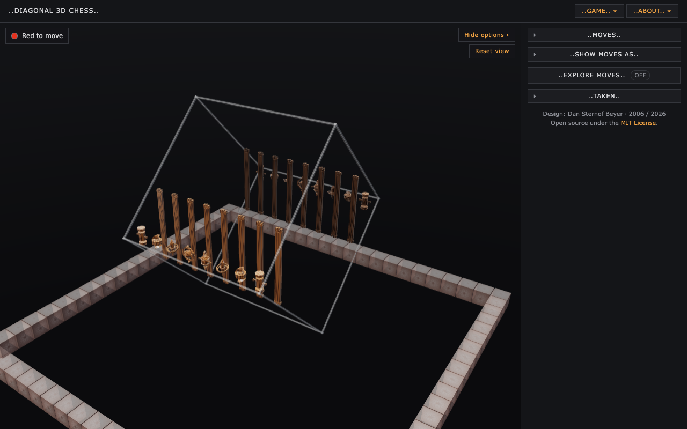
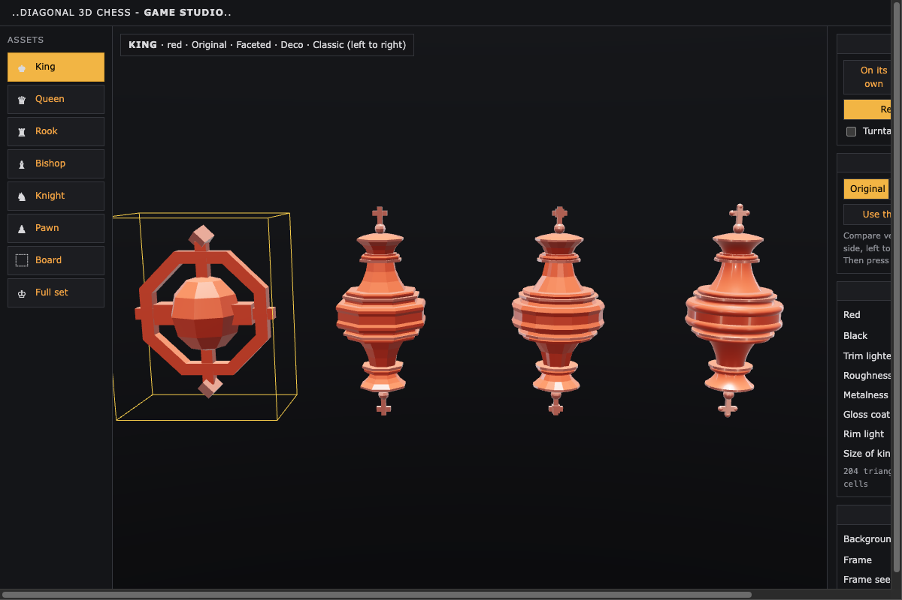
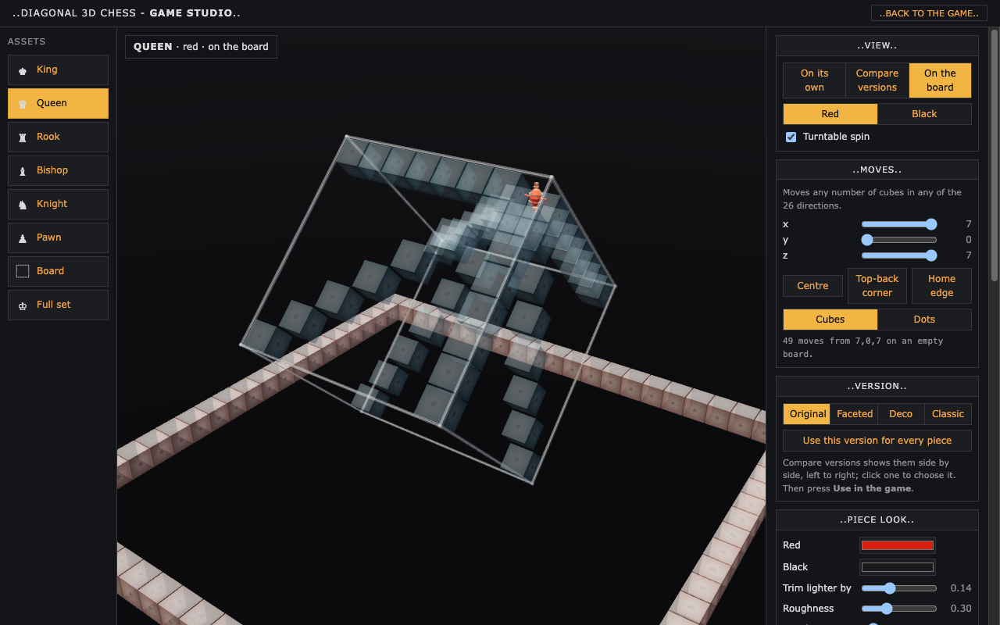

# Diagonal 3D Chess

A browser remake of **Diagonal 3D Chess**, first made in 2006 as an art-school senior
thesis in Macromedia Director 3D (Maya models, Lingo code). Original site:
<https://thehinge.net/3dchess/>



The board is an 8 × 8 × 8 cube tilted 45° so one edge points at each player.
Pawns fill a whole upright row of cubes and **grow** as they cross the board.

## Play online

[](https://dansternofbeyer.github.io/diagonal-3d-chess/)

The quickest way to try it: click the button above and the game opens in your
browser. Nothing to download. (The piece studio is at
[game-studio.html](https://dansternofbeyer.github.io/diagonal-3d-chess/game-studio.html).)

## Download and play

Want to keep it, or play without internet? Download it instead.
No account, no install and no internet needed once it's downloaded.
It works on Mac and Windows computers, in Chrome, Edge, Firefox or Safari.

### 1. Download

[](https://github.com/dansternofbeyer/diagonal-3d-chess/archive/refs/heads/main.zip)

Click the green button above. A file called **`diagonal-3d-chess-main.zip`** goes to
your **Downloads** folder. (It's about 3 MB.)

### 2. Unzip it

A ZIP file is a box with the game folder packed inside. Take the folder out first:

- **Mac:** open your Downloads folder and **double-click** `diagonal-3d-chess-main.zip`.
  A folder called `diagonal-3d-chess-main` appears next to it.
- **Windows:** open your Downloads folder, **right-click** `diagonal-3d-chess-main.zip`,
  choose **Extract All…**, then click **Extract**. A folder called
  `diagonal-3d-chess-main` opens.

You can move that folder anywhere you like, such as your Desktop.

### 3. Play

Open the `diagonal-3d-chess-main` folder and **double-click `index.html`**.
The game opens in your web browser.

**Bookmark it** to come back later, or just double-click `index.html` again.
Your game in progress is remembered.

### If something goes wrong

- **Blank or broken page on Windows?** You probably opened the file from inside
  the ZIP. Do step 2 (Extract All) first, then open `index.html` from the new folder.
- **It opened in a text editor or another program?** Right-click `index.html`, choose
  **Open With**, and pick your web browser (Chrome, Edge, Firefox or Safari).
- **Still stuck?** Update your browser to the newest version.

### How to play

Drag to spin the board, scroll to zoom. Click a piece to see where it can move,
then click a highlighted spot. The **ABOUT** menu at the top has **How to play** and
the moves of every **Piece**.

To look at the pieces up close and change how they look, double-click
**`game-studio.html`** instead.

## What you can do

- **Spin, pan and zoom**: left-drag spins; middle-drag (hold the wheel down),
  right-drag or shift-drag pans; scroll or pinch zooms.
- **Select a piece** to see where it can go, then click a highlighted cube to move.
  Orange cubes are captures.
- **Moves are animated**: rooks, bishops and queens slide along their lines, knights
  travel an L, and pawns grow or shrink as they change rows.
- **Taken pieces** pop up on the rose rail, beside the player who took them.
- **Hide options** (top right) gives the board the whole window; **Reset view** goes
  back to the starting camera. Each options box opens and closes from its heading
  (all start closed) and remembers its state.
- **GAME** menu (top): New game, Save, Load. **ABOUT** menu: How to play, Pieces,
  Philosophy, Studio.
- **The game in progress is kept** in this browser, so going to the Studio and back,
  or reloading, doesn't reset it.
- **Show moves as** any mix of glass cubes, glowing dots and **cube edges** (a thin
  outline of each cube), plus optional **move lines**: a thin line along each move's
  path, through every cube it passes. The selected piece's own cube is outlined in gold.
- **Castling**, exactly as in 2D chess, along the home edge (see the king below).
- **Explore moves**: switch it ON and click several pieces (either side) to see all
  their moves at once. Red's moves are red, Black's white, and cells both sides can
  reach are purple. Switch it OFF to play again.
- **Classic or free moves.** Free moves let any piece go anywhere on a chosen plane:
  the original's "incorrect move", so players set the rules, not the program.
- **Undo** (in the Moves box), and **take a piece off the board** by hand: select it
  and press **Delete**.
- **Save** downloads a `.txt` file of the board. **Load** (or drag the file onto the
  board) sets it up again. The file is plain text you can edit by hand to make puzzles.

## The pieces

| Piece  | Moves |
|--------|-------|
| King   | One cube in any of 26 directions. Castles as in 2D chess along its home edge: two cubes toward a rook, which jumps to its other side. Only if neither has moved, the cubes between are empty, and the king is not in check and doesn't cross or land on an attacked cube. |
| Queen  | Any distance in any of 26 directions |
| Rook   | Any distance in 18 directions: 6 straight + 12 flat diagonals |
| Bishop | Any distance in 20 directions: 12 flat diagonals + 8 corner-to-corner diagonals |
| Knight | Two out, one over, in 3D: 24 jumps |
| Pawn   | Fills an upright row of cubes. Steps one plane forward (two from its start) into an empty row. Captures one plane forward and one file to the side, taking every enemy in that row. Promotes at the far edge. Guards the diagonal it stands across: no piece can move diagonally through a pawn. |

## Piece versions

Every piece comes in three versions, chosen per piece in the Studio
(**Compare versions** shows them side by side):



- **Original**: the 2006-style pieces.
- **Ornate**: the original shapes, dressed with architectural "greebles" from wood
  moldings and mantels: ogee, cove, quarter-round and bead bands, dentil courses,
  fluted pilaster faces and cornice caps. Its knight is a raven: a heavy hooked beak,
  a bead eye and shaggy throat hackles, cut in the set's faceted style.
- **Classic**: classic Staunton chess pieces crossed with architectural moldings
  (torus, scotia, fillet, collar, baluster stem), smooth and curved. Each is like two
  classic pieces joined at their bases, so it reads the same from above and below.
  The knight has a sculpted 3D horse head at both ends, both facing the same way:
  a long flat face, a rounded jowl, a soft muzzle with nostrils and chin, small
  almond eyes under a brow, upright ears and a carved mane.

Every knight, in every version, faces the opponent.

**Wood grain.** By default the pieces are rendered in wood: golden wood for Red and
dark walnut for Black. The grain is painted by a shader as if each piece were
turned from a log, so it flows along the piece. Switch to plain gloss colours, or
change the wood colours, under **Finish** in the Studio.

Glowing things light up their surroundings: the selected piece casts a warm yellow
light and the move dots or cubes cast their colour onto nearby pieces.

## The Game Studio



`game-studio.html` shows every 3D asset on its own (inside an outline of its cell)
or on the board with its moves lit up, plus the board and the full starting set.
You can change colours, sizes, materials (trim lightness, gloss coat, rim light),
haze (depth fog, so far things fade a little) and highlight styles. The Keep changes
box is at the top of the panel:

- **Use in the game** keeps your changes in this browser.
- **Download look-settings.js** makes them permanent: replace `js/look-settings.js`.
- **Load a .glb** previews a new model from Blender before you bundle it in.

## Changing the 3D models (Blender)

The pieces are built in Blender by `blender/build_pieces.py` (also saved as
`blender/pieces.blend`).

The classic-style versions come from `blender/build_classic_pieces.py` (exports
`models/<piece>-classic.glb`), the ornate version from
`blender/build_ornate_pieces.py` (`models/<piece>-ornate.glb`).

1. Edit the pieces in Blender, or change the script and run it (Scripting tab → Run).
2. Export each piece to `models/<name>.glb` (the script does this).
3. In this folder run: `python3 tools/bundle_models.py`
   This packs the `.glb` files into `models/pieces.js`, which is what lets the page load
   models from a double-click.

## Files

```
index.html           the game
game-studio.html     the asset studio
js/chess-rules.js    rules, moves, save/load (no 3D code)
js/chess-scene.js    3D board, pieces, highlights (shared by both pages)
js/look-settings.js  default colours and sizes
models/*.glb         piece models exported from Blender
models/pieces.js     the same models bundled for the page (generated)
blender/             Blender file and the script that builds the pieces
tools/               bundle_models.py
lib/                 three.js r147 + OrbitControls + GLTFLoader (MIT)
docs/                screenshots
Documents/           the project's goals and links
```

## Credits and licenses

- Design, code and models: Dan Sternof Beyer. Code is open source under the
  [MIT License](LICENSE).
- The piece designs are recreated from the 2006 originals by the same author.
  The classic and ornate versions, the horse and raven heads and the wood colours
  were drawn from reference photos (a Staunton chess set, wood moldings, a horse's
  head, a carved knight, a raven, wood grain). Those photos belong to others and
  are not included in this repository.
- The lighting is a small hand-written shader (`STUDIO_FRAGMENT_SHADER` in
  `js/chess-scene.js`) that paints a dark photo studio with an overhead softbox,
  used as the reflection map, plus a rim-light addition to the piece material.
- The glass-tile textures are drawn by code (`makeOrnamentTexture` in
  `js/chess-scene.js`) in the spirit of the 2006 textures, which were too small to reuse.
- [three.js](https://threejs.org) r147, including OrbitControls and GLTFLoader:
  MIT License, Copyright © 2010–2022 three.js authors.
